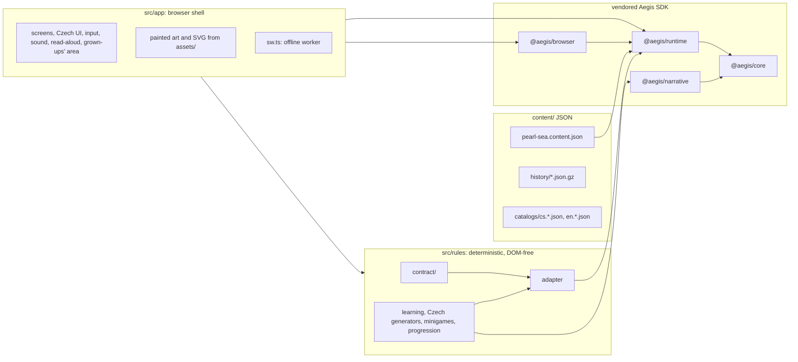

# Architecture

Perlové moře (Pearl Sea) is a static, offline-installable web app built as a **standalone consumer
of the Aegis action-driven SDK**, with the same architecture as its sister game Dragon Valley
([plan.md](plan.md) §7). Authoritative game logic is deterministic and headless; the browser is a
presentation adapter. This document describes the layers, the data flow, content and language,
persistence and same-origin isolation, offline installation and the build. The domain types are in
[contract.md](contract.md), the game in [design.md](design.md) and the curriculum in
[curriculum.md](curriculum.md).

The foundations are in place: the toolchain, the pinned SDK, the build with its offline resource
graph and worker, the reading font, a Czech title screen, the storage names and their isolation
tests, CI and Pages. The rules and their adapter (S2), the content (S3) and the full shell (S4) are
being ported from Dragon Valley, whose code is the reference implementation; each section says what
is still planned. Who owns which path is in [contract.md](contract.md) §2.

## 1. Layers



| Layer   | Path            | May use                                                                  | Must not use                                                                                                     |
| ------- | --------------- | ------------------------------------------------------------------------ | ---------------------------------------------------------------------------------------------------------------- |
| Rules   | `src/rules/**`  | `@aegis/core`, `@aegis/runtime`, `@aegis/narrative`, other rules modules | DOM, Node built-ins, `@aegis/browser`, `src/app`, clocks, `Math.random`, transcendental `Math`, locale functions |
| Shell   | `src/app/**`    | everything public in the SDK, the rules                                  | Node built-ins, three.js, the renderer, network beyond same-origin files                                         |
| Worker  | `src/app/sw.ts` | `@aegis/browser/offline`, `@aegis/browser/offline/worker`                | anything else                                                                                                    |
| Tooling | `scripts/**`    | Node, esbuild, the SDK                                                   | shipping to players                                                                                              |

TypeScript projects and ESLint enforce the boundaries. `src/rules` is type-checked with
`lib: ["ES2022"]` and no types, so a `document` or `node:fs` reference is a type error; the shell is
checked with the DOM library and the worker, separately, with the WebWorker library. ESLint keeps
`@aegis/browser`, `src/app` and `node:` imports out of the rules. In the rules, and in every test
outside `test/e2e/`, it rejects `Date`, `performance`, `Intl`, the global `crypto`, `Math.random`,
transcendental `Math` (`sin`, `exp`, `pow`, `log`, …), the `**` operator and locale functions
(`localeCompare`, `toLocaleString`, …). Czech alphabetical order (_ch_ after _h_) is therefore
computed by the rules themselves, never by the host's collation. The build refuses Node built-ins,
three.js and `@aegis/render-three` in any browser bundle.

## 2. The command loop

Today the shell only boots. `src/app/main.ts` reads the deployment base and offline revision from
the page, loads the reading font (waiting at most 2.5 s, then swapping when it arrives) and the
Czech UI catalog, and shows the title screen; if the page or the catalog is broken it shows a Czech
failure screen with a retry button. Nothing is exposed on `window` and no storage is touched.

The game's loop is planned (S2 ports the adapter, S4 the shell); every SDK piece it names is in the
pinned set:

1. The shell renders the current view (screens never read state directly).
2. A control captures the view's revision when rendered. On activation it dispatches an action with
   `{ expectedRevision }`.
3. `@aegis/runtime` validates the action, asks the adapter to `resolve` it (legality, turn cost),
   runs the command's `start`/`turn`/`finish` on a staged copy, drains due jobs, validates the new
   state, projects the view and publishes one commit atomically:
   `{ revision, turn, hash, view, events, snapshot }`.
4. The checkpoint bridge persists that exact snapshot before the next substep (strict saves).
5. The shell re-renders from the new view and plays one-shot effects (sounds, bubbles, ink blots)
   from the commit's events.

Invalid actions change nothing. Time enters only as action payload data (`startSession.day`,
`answer.elapsedMs`), and randomness only from the runtime's named streams, which also decide when an
Inkoustík ambushes a round. A replay of the same actions on the same content and seed therefore
yields the same hashes on every machine and browser.

## 3. Content, catalogs and language

| Path                                             | Contents                                                                                                   |
| ------------------------------------------------ | ---------------------------------------------------------------------------------------------------------- |
| `content/pearl-sea.content.json`                 | the content pack: the annotated Czech lexicon, levels, story and activities (S3, planned)                  |
| `content/history/<revision>.json.gz`             | every shipped pack, byte for byte, gzip-compressed, for save migration (written by `npm run content:bump`) |
| `content/catalogs/cs.ui.json`, `cs.content.json` | Czech: every string of the game                                                                            |
| `content/catalogs/en.ui.json`, `en.content.json` | English, only keys starting `grownups.`: the grown-ups' area has an English switch                         |

Today only `cs.ui.json` exists (the title screen); the other catalogs come with the content (S3) and
the full shell (S4). The child's UI is Czech, because Czech is the subject; the grown-ups' area is
Czech with an English switch. The page is `<html lang="cs">`. Every catalog follows the variant
convention of [contract.md](contract.md) §7.4: the bare key is the neutral phrasing, `.boy` and
`.girl` come as a pair, Czech plurals `.one`, `.few` and `.other` as a set, and the shell picks the
variant for the child's form of address and the count.

The content gate `scripts/validate-content.mjs` (part of `npm run verify`, with
`--strict-coverage`) loads the domain contract (bundled with esbuild, as Dragon Valley's gate does)
and checks:

- every catalog is a flat map of non-empty strings for a supported locale (`cs`, `en`),
  `cs.ui.json` exists, and a key lives in one Czech scope only;
- the variant convention (`catalogProblems`); English holds only `grownups.*` keys that Czech has,
  and every Czech `grownups.*` string has its English twin;
- Czech typography („…“ and ‚…‘ quotation marks, the ellipsis …, the en dash – instead of a spaced
  hyphen, no space before , . ; : ! ? and none inside quotation marks or brackets) and that every
  character of every catalog is in the reading font;
- once S3 ships it, the content pack under the contract's registration (schema, references,
  reachability, skills, activities, balance and the lexicon's linguistic checks), every catalog key
  it uses (grammar terms included) in Czech, its story lines within the child profile (at most 10
  words a sentence), and the archived packs in `content/history/` (gzip archives that decompress
  to valid packs named by their revision, and nothing else);
- art references against `assets/art/catalog.json` once S5 publishes it (reported, or failing with
  `--strict-art`);
- curriculum coverage: every objective of [curriculum.md](curriculum.md) has a lesson and a monster
  level, so has every objective the pack lists, and the pack's levels teach exactly the objectives
  the document maps to them.

On screen, a one-letter preposition or conjunction (k, s, v, z, o, u, a, i) is bound to the next
word with a no-break space (`src/app/i18n/typography.ts`); catalogs keep ordinary spaces. A missing
catalog key is a defect and is never shown to a child as a raw key. The only Czech text outside the
catalogs is the page shell in `index.html` (title, splash, `noscript`) and the startup-failure
screen in `main.ts`, built in because the catalog may be what failed. The reading font, Pearl
Reading, is described in [assets.md](assets.md) §6.

## 4. Persistence and profiles

All storage is local IndexedDB through `@aegis/browser` (no accounts, no cloud), in this game's own
database `pearl-sea` (`IndexedDbSaveStorage`, never the SDK default `aegis-saves`). The names are
fixed in `src/rules/contract/persistence.ts`; the save code itself is ported from Dragon Valley by
S4 (planned).

| Record                      | `SaveService` game ID   | Profile ID                | Contents                                                                                                                                                                                                                  |
| --------------------------- | ----------------------- | ------------------------- | ------------------------------------------------------------------------------------------------------------------------------------------------------------------------------------------------------------------------- |
| Family record               | `pearl-sea-family`      | `family`                  | up to four child profiles in fixed slots: name (up to 16 characters), diver avatar (`diver-1` … `diver-8`), grade (3 or 4), form of address (`boy`, `girl`, `neutral`); and the device's grown-ups' language (`cs`, `en`) |
| Game save (one per child)   | `pearl-sea`             | `profile-1` … `profile-4` | the runtime snapshot, via `createSaveCheckpoint`                                                                                                                                                                          |
| Preferences (one per child) | `pearl-sea-preferences` | `profile-1` … `profile-4` | presentation and shell preferences                                                                                                                                                                                        |
| Day record (one per child)  | `pearl-sea-day`         | `profile-1` … `profile-4` | the child's day (S4 defines it, after Dragon Valley's day record)                                                                                                                                                         |

- A profile's runtime seed is fixed per slot (`pearl-sea:profile-1` …), so a reset profile replays
  the same sequence for the same actions; children still differ because their actions do. Names,
  avatars, the form of address, the grown-ups' language and presentation preferences are not game
  state and never enter a game hash. The grade is picked in the profile editor and handed to the
  game at the first session, as in Dragon Valley ([contract.md](contract.md) §14).
- Each game save is written through the **strict checkpoint bridge** (planned): every commit is
  durable before the next substep; a failed write shows "not saved, retry" and the shell calls
  `retryCheckpoint` then `continuePending`, never re-dispatching the action.
- Invalid, future or incompatible saves show recovery screens (export the original bytes, import a
  backup, restore the previous copy, or a confirmed reset), never a silent new game (planned).
- Saves pin their content revision. Upgrades restore with the archived pack from `content/history/`
  and activate the new pack at a hub boundary ([contract.md](contract.md)).
- Browser storage can be evicted: the grown-ups' area offers backup export and import per child
  (format `pearl-sea-backup`, files named `pearl-sea-….json`) and requests
  `navigator.storage.persist()` when installing for offline use (planned, S4).

## 5. Same-origin isolation from Dragon Valley

Perlové moře (`https://rumukh.github.io/pearl-sea/`) and Dragon Valley
(`https://rumukh.github.io/dragon-valley/`) share one origin, `https://rumukh.github.io`. IndexedDB,
Cache Storage, Web Locks and service-worker registrations belong to the whole origin and are told
apart only by name or scope. Every storage name of this game therefore belongs to it alone, and
`src/rules/contract/persistence.ts` is their registry:

| Storage                                          | Perlové moře                                                                  | Dragon Valley                      |
| ------------------------------------------------ | ----------------------------------------------------------------------------- | ---------------------------------- |
| IndexedDB database                               | `pearl-sea`                                                                   | `dragon-valley`                    |
| `SaveService` game IDs                           | `pearl-sea`, `pearl-sea-family`, `pearl-sea-preferences`, `pearl-sea-day`     | `dragon-valley`, `dragon-valley-…` |
| Offline pack ID and `OfflinePackStore` namespace | `pearl-sea`                                                                   | `dragon-valley`                    |
| Caches (named by the SDK)                        | `aegis:pearl-sea:catalog`, `aegis:pearl-sea:pack:pearl-sea:<revision>:<uuid>` | `aegis:dragon-valley:…`            |
| Web Locks (named by the SDK)                     | `aegis:pearl-sea:revision:<key>`                                              | `aegis:dragon-valley:…`            |
| Offline worker scope                             | `/pearl-sea/` (the deployment base)                                           | `/dragon-valley/`                  |
| Worker error message                             | `pearl-sea-offline-error`                                                     | `dv-offline-error`                 |
| Backup format                                    | `pearl-sea-backup`                                                            | `dragon-valley-backup`             |

The game uses no localStorage, sessionStorage or cookies and reaches browser storage only through
the SDK. The SDK deletes caches only by their exact names, so neither game can remove the other's
offline files.

- `test/unit/persistence/origin-isolation.test.ts` proves that no name can equal or extend one of
  Dragon Valley's, or be extended by one (Dragon Valley's names pinned from dragon-valley@13c1482);
  runs the real SDK offline store in one CacheStorage shared with Dragon Valley's installed pack
  (install, a failed install, removal, Web Locks) without changing a byte of Dragon Valley's; checks
  that this game's worker refuses Dragon Valley's paths; and scans `src/` for direct storage APIs
  (localStorage, sessionStorage, cookies, raw IndexedDB, Cache Storage, service-worker registration,
  Web Locks, BroadcastChannel) and for SDK stores built with other names.
- `test/e2e/isolation.spec.ts` seeds Dragon Valley's save and offline caches under Dragon Valley's
  real names, boots this game again and checks in real browsers that they survive unchanged and that
  every database, cache and worker scope on the origin belongs to one of the two games.

Every new storage name goes into `persistence.ts`, and the isolation test fails until its checks
cover the new name too. The storage quota, the `navigator.storage.persist()` grant and the browser's
"clear site data" are origin-wide: they apply to both games together.

## 6. Offline installation

- `scripts/build.mjs` emits `resource-graph.json` (pack ID `pearl-sea`): every shipped file with its
  exact byte count, SHA-256 and kind, validated at build time by the SDK's own
  `validateOfflinePack`. The graph's revision is a digest of the resource list. `sw.js`,
  `resource-graph.json` and `build-report.json` describe or install the graph and are not members
  of it.
- `src/app/index.html` carries the placeholders `%PS_BASE%`, `%PS_OFFLINE_REVISION%` and `%PS_CSP%`.
  The build fills them, so the page declares its deployment base (meta `ps-base`), its offline
  revision (meta `ps-offline-revision`) and its Content-Security-Policy.
- `sw.js` is bundled from the public `@aegis/browser/offline/worker` export. The build defines
  `__PS_OFFLINE_PACK_ID__`, `__PS_OFFLINE_NAMESPACE__`, `__PS_OFFLINE_REVISION__` and
  `__PS_OFFLINE_ERROR_MESSAGE__`, so the worker reads only `aegis:pearl-sea:…` caches, serves only
  the pinned revision's verified files, denies other requests, never calls `skipWaiting` and never
  forces a reload. When serving fails, it tells its pages only that it failed (a message of type
  `pearl-sea-offline-error`); no request data or state leaves the worker.
- "Install for offline play" in the grown-ups' area (planned, S4) runs `OfflinePackStore.install`
  with the graph (all-or-nothing, digest-checked) and then `registerOfflineWorker('sw.js', base)`,
  whose scope is `/pearl-sea/`. Until then the worker is built and tested but never registered.
- A new deployment is a new revision. It is installed explicitly and activated at a safe boundary;
  saves migrate through content history (§4).
- Budgets: 32 MiB per file, 64 MiB per pack, at most 4096 files, no empty files.

## 7. Child safety and privacy

- A same-origin **Content-Security-Policy**, the same as Dragon Valley's (`scripts/lib/site.mjs`):
  `default-src 'self'`, no remote scripts, styles, fonts, images, media or connections, no objects,
  no form submission. The build puts it in a meta element (GitHub Pages cannot send headers) and the
  local server also sends it as a header. Even a mistaken dependency cannot load a CDN or call home.
- No telemetry, analytics, ads, purchases, accounts, outbound links or embedded frames. The full
  shell checks views with `assertChildSafeView` from `@aegis/browser` before mounting them (planned,
  S4).
- Read-aloud uses only the device's local Czech voices (Web Speech API, `localService`) and is
  hidden when the device has none (planned, S4). Nothing is recorded or sent.
- Children's names live only in the family record on the device. The page sends no referrer and
  writes nothing to the console.

## 8. Build, deploy and the gate

| Command                                                  | What it does                                                                                                                                                                                                                                             |
| -------------------------------------------------------- | -------------------------------------------------------------------------------------------------------------------------------------------------------------------------------------------------------------------------------------------------------- |
| `npm run build -- --base /pearl-sea/`                    | esbuild bundles of `src/app/main.ts` and the worker, copies the content a player needs (the pack, its catalogs and the history archives) and runtime assets, writes `licenses.txt` and the resource graph, and moves the verified site into `dist-site/` |
| `npm run serve`                                          | builds into `out/dev-site-*` and serves on `http://127.0.0.1:4330/` with the same CSP; rebuilds on change (refresh after "rebuilt"). Dragon Valley uses 4320                                                                                             |
| `npm run verify`                                         | the gate: build, typecheck (rules, app, worker, tests), lint, format, content, Vitest, lockfile ([testing.md](testing.md) §1)                                                                                                                            |
| `npm run test:e2e`                                       | Playwright at the Pages base on port 4331 (system Edge locally; Chromium, Firefox and WebKit on CI)                                                                                                                                                      |
| `npm run content:bump -- <revision>`                     | gives a content change its own revision and archives the deployed pack, gzip-compressed, in `content/history/`                                                                                                                                           |
| `npm run fonts:subset -- --source <Andika-7.000 folder>` | rebuilds the reading font ([assets.md](assets.md) §6)                                                                                                                                                                                                    |
| `npm run lockfile:fix`                                   | rewrites corporate-feed URLs in `package-lock.json` to the public registry ([sdk-update.md](sdk-update.md))                                                                                                                                              |

A build is staged next to its output and moved into place only after the finished site has been
re-read and verified; `--clean` replaces only a previous Pearl Sea build.

CI (`.github/workflows/ci.yml`) runs the gate on `ubuntu-latest` and `windows-latest` and audits its
record in a separate step (`node scripts/verify.mjs --audit .verify-report.json`); the e2e jobs run
the browser suite ([testing.md](testing.md) §5), one job per engine (Chromium, Firefox, WebKit).
Pages (`.github/workflows/pages.yml`) builds with base `/pearl-sea/`, re-checks the artifact with
`scripts/check-site.mjs` and deploys it. The SDK is a pinned, digest-checked tarball set
([sdk-update.md](sdk-update.md)).

## 9. Repository layout

```
vendor/aegis/<version>/   SDK tarballs + artifacts.json (pinned, digest-checked)
content/                  catalogs/ (cs.ui.json now); the pack and history/ follow (S3)
src/rules/                contract/ (storage names, the domain contract); the rules (S2)
src/app/                  main.ts, index.html, sw.ts, design/, i18n/, styles/ (+ S4's screens, …)
assets/                   fonts/pearl-reading/ now; art/ and audio/ with provenance (S5)
scripts/                  build, serve, verify, check-site, validate-content, content-bump,
                          canonicalise-lockfile, fonts/, lib/ (site, tools, curriculum, history)
test/                     unit/, tooling/, e2e/, fixtures/ (+ traces/, sim/, migration/ later)
docs/                     plan, design, curriculum, contract, architecture, testing, assets,
                          sdk-update; images/ (style tests)
```
