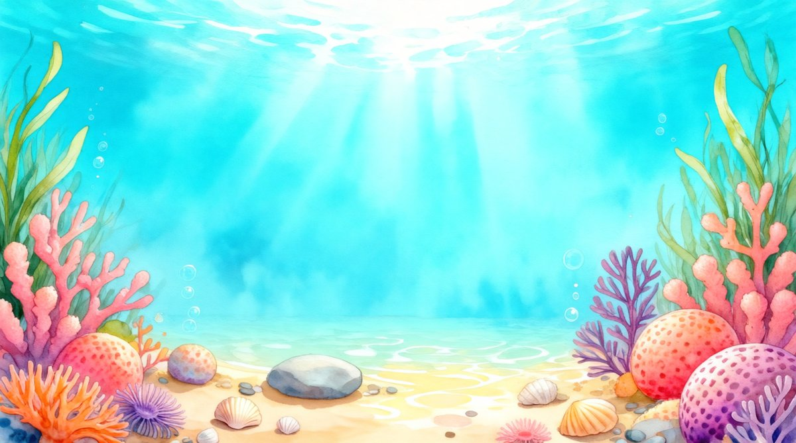
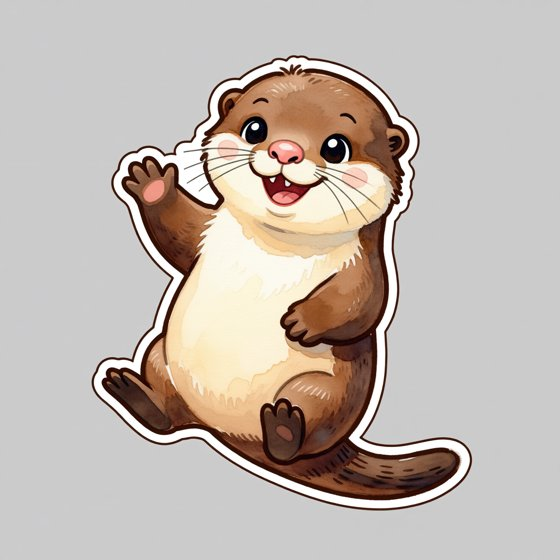
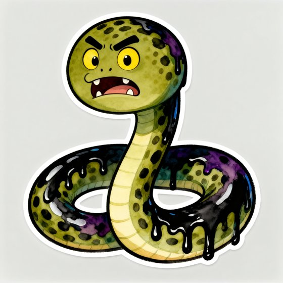

# Perlové moře (Pearl Sea): a Czech-language adventure for 3rd and 4th graders

A colourful, offline-capable web game that teaches Czech grammar and spelling (_mluvnice a
pravopis_) to children in the **3rd and 4th grade** of Czech primary school, set in an
undersea world of friendly creatures and sea monsters. It is a sister game of Dragon Valley:
the **same Aegis action-driven SDK**, the same architecture and the same proven learning engine,
with a new subject, a new world and art made only with **local AI models** on this PC.

**Status:** approved by the user on 2026-10-31 (title, repo, story, regions, activities, local-only art, delivery). Changes to this plan are recorded here with their reason.

**First local style tests** (Qwen Image Edit 2511 on this PC, about 12 minutes each, no cloud). The
lagoon came from a rough composition sketch; the open water in the middle is left for the UI.

| Sea friend test: Vydra Výskalka                          | Monster test: Muréna Mumla (inked)                                             |
| -------------------------------------------------------- | ------------------------------------------------------------------------------ |
|  |  |
| Works as is; the white sticker outline cuts out cleanly  | Style works; the anatomy came out as a snake, so monster briefs get real-animal features (a moray's fin crest, gill, no hood) |

---

## 0. Decisions

| Topic         | Decision (proposed)                                                                                                                                                                             |
| ------------- | ----------------------------------------------------------------------------------------------------------------------------------------------------------------------------------------------- |
| Kind of game  | 2D adventure on the Aegis action SDK, exactly like Dragon Valley: deterministic headless rules, DOM + painted art + SVG UI, touch-first with full keyboard, saves, works offline, installable |
| Repository    | New public repo **`rumukh/pearl-sea`**, MIT, deployed to GitHub Pages (`/pearl-sea/`)                                                                                                         |
| Engine        | The **same pinned Aegis SDK tarball set** Dragon Valley uses (`0abd61b`), vendored and digest-checked. Dragon Valley's toolchain, build, offline pack, saves, family profiles and grown-ups' area are forked |
| Players       | Czech 3rd and 4th graders (8-10 years). A **grade per child** (3 or 4), like Dragon Valley's grade setting; up to 4 children per device                                                        |
| Curriculum    | ČJL _jazyková výchova_ for grades 3-4 (RVP ZV 1st period and the start of the 2nd), matched to common textbooks. Reading/literature and handwriting are out of scope                          |
| UI language   | **Czech** for the child (it teaches Czech). The grown-ups' area is **Czech with an English switch** (decided)                                                                                   |
| Art           | **Painted 2D art made locally**: Qwen Image Edit Plus 2511 in WanGP (offline) for backgrounds, creatures and monsters, local `rembg` cut-outs, WebP. SVG for UI, icons, eggs and cosmetics. **No Azure, no cloud** |
| Music and SFX | Music loops from **ACE-Step 1.5 (local)**; SFX from Dragon Valley's deterministic synthesis pipeline, re-voiced for water (bubbles, splashes, shells)                                         |
| Read-aloud    | The device's **local Czech voices only** (Web Speech API, `localService`); hidden when the device has none                                                                                     |
| Kindness      | As Dragon Valley: no lives, no losing, no red X, no streak shaming, no ads, no purchases, no accounts, no network beyond the game's own files                                                  |

---

## 1. Story

**Perlové moře** lies deep under the waves. Every Czech word lives there as a pearl in the
**Velká lastura** (the Great Shell), looked after by **Profesorka Osmička**, a wise octopus
teacher with eight arms and round glasses.

One stormy night the giant **Krakatice Inkoustová** (a kraken-like giant squid) squirted a cloud
of magic ink. The pearls went dull, letters got smudged (_i, or y?_), words fell apart, and the
creatures' eggs drifted away. Worst of all, some sea creatures soaked in ink turned into grumpy
**sea monsters** that guard every part of the sea.

The child is the new **Lovec perel** (Pearl Diver), steering the little yellow submarine
**Bublinka**. Practice polishes pearls, hatches eggs into sea friends, and **washes the ink off
the monsters**, who turn back into friendly creatures and thank you. Down in the abyss waits the
Krakatice herself: wash her ten arms clean, one curriculum strand per arm. She was only lonely,
and becomes the sea's new guardian.

Tone: exciting but never scary (monsters are grumpy and inky, not gory); short sentences checked
by the narrative child-profile validator; every line can be read aloud.

---

## 2. The sea and the curriculum

The child dives **deeper with every region**: sunny shallows for the 3rd grade, the mysterious
deep for the 4th. Each region has 5-6 lessons and a **monster** at its end (about 70 levels).

| #   | Region (ID)                          | Grade | Curriculum                                                                                                                                                                                 | New sea friends                                          | Monster                                  |
| --- | ------------------------------------ | ----- | ------------------------------------------------------------------------------------------------------------------------------------------------------------------------------------------ | -------------------------------------------------------- | ---------------------------------------- |
| 1   | Slunná laguna (`sunny-lagoon`)       | 3     | Review of 2nd grade: alphabet and alphabetical order (_ch_ after _h_), short/long vowels, hard and soft consonants, _dě tě ně_, _bě pě vě mě_, _ú/ů_, paired consonants, capital letters in names | Krab Tvrďák, Medúzka Měkulka, Želva Obojka (choose one first) | Muréna Mumla (mumbles word endings)      |
| 2   | Korálový útes (`coral-reef`)         | 3     | Vyjmenovaná slova after **B, L** and related words                                                                                                                                        | Barakuda Bystřinka, Lachtan Lyžař                        | Žralok Žrout (eats the i's and y's)      |
| 3   | Chaluhový les (`kelp-forest`)        | 3     | Vyjmenovaná slova after **M, P**                                                                                                                                                           | Koník Mýdlínek, Pyskoun Pyšný                            | Mořský had Zamotal (tangles words)       |
| 4   | Pirátský vrak (`pirate-wreck`)       | 3     | Vyjmenovaná slova after **S, V, Z**                                                                                                                                                        | Ježík Syčík, Vydra Výskalka, Jazyk Jazýček               | Ďas Lucerník (lures with false spellings) |
| 5   | Perlová zátoka (`pearl-bay`)         | 3     | All vyjmenovaná slova mixed, word families, sound-alike pairs (_být/bít, mýt/mít, výr/vír_); synonyms, antonyms, general/specific words                                                     | Hvězdice Rodinka                                         | Zéva Lakomá (a greedy giant clam)        |
| 6   | Sopečné prameny (`volcanic-vents`)   | 3     | The ten parts of speech (_slovní druhy_), inflected and uninflected                                                                                                                         | Kalmar Desetiruký                                        | Lávový úhoř Žhavák                       |
| 7   | Ledové moře (`ice-sea`)              | 3     | Nouns: gender, number, the 7 cases and their questions; verbs: person, number, tense, infinitive; sentence and compound sentence                                                            | Tuleň Pádík, Delfín Skokánek                             | **Mořská saň Ledana** (3rd-grade finale) |
| 8   | Měsíční jeskyně (`moon-caves`)       | 4     | Word structure: root, prefix, suffix, ending; word families                                                                                                                                | Rak poustevník Kořínek                                   | Humr Nůžkař (snips words to pieces)      |
| 9   | Potopené město (`sunken-city`)       | 4     | Prefixes versus prepositions (together or apart), _bě/bje, vě/vje, pě, mě/mně_                                                                                                              | Štítovec Přísavka                                        | Medúza Lepka (glues words together)      |
| 10  | Temný příkop (`dark-trench`)         | 4     | Noun patterns (_vzory_): all 14, finding the pattern, declension                                                                                                                           | Klipka Vzorná                                            | Chobotnice Napodobnice (copies patterns) |
| 11  | Bouřlivé moře (`storm-sea`)          | 4     | Verbs: person, number, tense, mood, simple and compound forms, reflexive verbs; standard and colloquial Czech                                                                              | (Delfín Skokánek grows up)                               | Vír Časoplet (a whirlpool that mixes tenses) |
| 12  | Krakatičí propast (`kraken-abyss`)   | 4     | Subject and predicate, **subject-predicate agreement** (_psi štěkali, kočky mňoukaly_), simple and compound sentences, conjunctions; grand review                                           | Klauni Dvojčata                                          | **Krakatice Inkoustová** (finale)        |

A 3rd grader starts in the lagoon; a 4th grader starts in the Moon Caves after a gentle placement
check, with the shallows open for review. Parents can unlock ahead. Exact objectives, stable IDs
and textbook alignment go into `docs/curriculum.md` (Phase 1), and a content gate fails on any
objective without a lesson and a monster.

### Sea friends double as mnemonics

| Friend                     | Topic                                 | The memory hook                                                       |
| -------------------------- | ------------------------------------- | --------------------------------------------------------------------- |
| Krab Tvrďák                | hard consonants _h ch k r d t n_ → _y_ | a hard shell with seven hard spikes                                   |
| Medúzka Měkulka            | soft consonants _ž š č ř c j ď ť ň_ → _i_ | soft jelly with nine soft tentacles                                   |
| Želva Obojka               | "both-way" consonants _b f l m p s v z_ | lives both in the sea and on the beach; eight shell plates            |
| Barakuda Bystřinka         | after **B** (_bystrý_)                 | the quickest fish of the reef                                          |
| Lachtan Lyžař              | after **L** (_lyže_)                   | a sea lion who skis down the waves                                     |
| Koník Mýdlínek             | after **M** (_mýt, mýdlo_)             | a seahorse blowing soap bubbles                                        |
| Pyskoun Pyšný              | after **P** (_pysk, pýcha_)            | a real wrasse with big, proud lips                                     |
| Ježík Syčík                | after **S** (_syčet_)                  | a porcupinefish that puffs up and hisses _sss_                         |
| Vydra Výskalka             | after **V** (_vydra, výskat_)          | the otter is itself a vyjmenované slovo                                |
| Jazyk Jazýček              | after **Z** (_jazyk_)                  | the sole really is called _jazyk_ in Czech                             |
| Hvězdice Rodinka           | word families                          | five arms, one heart: related words share a root                       |
| Kalmar Desetiruký          | 10 parts of speech                     | ten arms, one part of speech in each                                   |
| Tuleň Pádík                | the 7 cases (_pády_)                   | slides (_padá_) down seven icy steps, one question on each             |
| Delfín Skokánek            | verbs                                  | always doing something: _skáče, plave, hraje si_                       |
| Rak poustevník Kořínek     | word structure                         | the root lives inside; prefixes and suffixes are the shell             |
| Štítovec Přísavka          | prefix versus preposition              | a remora sticks to the shark like a prefix sticks to its word          |
| Klipka Vzorná              | noun patterns                          | a butterflyfish covered in patterns (_vzory_)                          |
| Klauni Dvojčata            | subject and predicate                  | twin clownfish who always swim together                                |

Each friend grows like a Dragon Valley dragon, by real mastery of its topic: **egg → baby → grown
up → crowned**. They get hungry when their words are due for review (that is the spaced
repetition), wear hats bought with coins, and live in Bublinka's home grotto.

### Monsters

- **12 region monsters**, each painted twice: **inked** (grumpy, smudged, a little spooky) and
  **freed** (clean, bright, smiling). A monster level is a battle: every right answer fires a
  bubble from Bublinka and washes ink off; misses never refill it; the monster tells little
  jokes and splashes harmless ink blots on the screen that the child wipes off with a tap. When
  the ink is gone it transforms on screen and joins the **friends' gallery**.
- **The finale**: Krakatice Inkoustová, ten inky arms, each cleaned with a different strand
  (as Dragon Valley's Seven-Headed Dragon is cured head by head). **Mořská saň Ledana** is the
  3rd grader's big finale before the deep.
- **Inkoustíci** (little ink monsters, 4 species): now and then one ambushes a round and
  smudges the next word. Answer it right to splash it away for a bonus coin. Seeded and
  deterministic, never a penalty.

---

## 3. Activities

| Activity                          | What the child does                                                                                     | Engine piece (from Dragon Valley)        |
| --------------------------------- | ------------------------------------------------------------------------------------------------------- | ---------------------------------------- |
| **Krmení** (core)                 | 8-12 problems; each right answer feeds a shrimp to the sea friend                                       | problem rounds, re-ask jobs              |
| **Inkoustová věta**               | a sentence with 1-3 ink-blot gaps (_b_t, l_že, ml_n_), filled one by one                                | multi-step problems                      |
| **Lov chyb**                      | the ink hid a mistake in a sentence: tap the wrong word, then fix it                                    | multi-step problems                      |
| **Určování**                      | which part of speech, gender, case, person, tense, pattern?                                             | problem activity                         |
| **Pexeso**                        | pairs: word ↔ related word, synonym ↔ synonym, singular ↔ plural, word ↔ pattern                        | `@aegis/narrative` `matching`            |
| **Perlový náhrdelník**            | thread word pearls in alphabetical order, or the vyjmenovaná slova in the order of the school rhyme      | `@aegis/narrative` `ordering`            |
| **Rybářské sítě**                 | drag fish-words into 2-4 nets: gender, part of speech, hard/soft, standard/colloquial                   | custom minigame + `createPlacement`      |
| **Ulita slov**                    | split a word into prefix, root, suffix and ending (4th grade)                                           | custom minigame                          |
| **Slovní rodinka**                | pick every word of one family; sound-alike families (_být_ vs _bít_) sit side by side                   | custom minigame                          |
| **Souboj s příšerou**             | the monster battle (above)                                                                              | boss rounds                              |
| **Závod s delfíny** (optional)    | 60-second race against your own best                                                                    | arena                                    |
| **Svačinka**, **Ukaž, co umíš**   | hungry friends' due reviews; the placement check                                                        | snack time, placement                    |

Input: choice buttons for new items, then letter keys (_i í y ý_, _d t_, _ú ů_ …) on a big on-screen
pad, and later typed words with a Czech on-screen keyboard. Hints show the **strategy**, not just
the answer: the word family (_mlýn → mlynář_), lengthening the word (_hrad → hrady_), the
_ten/ta/to_ test, the case question, the pattern's endings.

---

## 4. Learning engine

Dragon Valley's engine carries over almost unchanged, because it is about items, not arithmetic:
Leitner boxes 0-5, re-asking a miss about three problems later, the 70-85 % success band, snack
time and first tastes, the review guarantee, pacing, placement, the daily adventure, time only
as action data, named random streams and golden traces.

What is new is the **domain**: a curated, annotated **lexicon** in the content pack (words, their
families, parts of speech, gender, pattern, segmentation, sentences), item IDs per word and skill,
Czech problem generators and distractors (_i↔y, í↔ý, ú↔ů, d↔t, ě↔je, mě↔mně_, apart↔together,
sibling categories), and linguistic consistency checks in the content gate (every vyjmenované-family
word has _y/ý_ after its consonant, segment pieces rebuild the word, every noun's pattern fits its
gender, no word appears twice with different spellings). Mastery shows as **pearls** in the Great
Shell (cloudy → bronze → silver → gold), Dragon Valley's Magic Window reborn.

---

## 5. Rewards, Czech UI and accessibility

- **Gold coins** from sunken treasure; spent at **U Mrože**, the shop of Mrož Vousáč (a walrus
  captain): hats, goggles, scarves, shell crowns, grotto decorations. **Sticker album**, **daily
  quests**, a **treasure chest** after the daily goal, **printable** flashcards of the hardest words
  and certificates (_diplom_). A diary card ends each session: _Dnes ses naučil(a): mlýn, slyšet!_
- **Czech grammar in the UI**: the profile asks _kluk / holka_ (or neither) so praise is grammatical
  (_Dokázal jsi to! / Dokázala jsi to!_, neutral phrasing otherwise); Czech plural forms
  (_1 mince, 3 mince, 5 mincí_).
- **Font**: Dragon Valley's Andika-based reading font, re-subset with every Czech letter
  (_ě š č ř ž ý á í é ú ů ď ť ň_, capitals too), because telling _i, í, y, ý_ apart is the subject.
- Text to 200 %, reduced motion, keyboard for everything, big touch targets, `aria-live` feedback,
  colour never the only signal.

---

## 6. Art and audio, local only

| Asset                                    | Count | Made with (all on this PC)                               |
| ---------------------------------------- | ----- | -------------------------------------------------------- |
| Sea friends, baby and grown up           | 36    | Qwen Image Edit 2511; baby derived from the approved adult |
| Monsters, inked and freed                | 24    | Qwen; freed form derived from the approved inked master  |
| Inkoustíci                               | 4     | Qwen                                                     |
| Region scenes, two sea maps, grotto, title | 16  | Qwen from composition sketches that leave space for UI   |
| Profesorka Osmička, Mrož Vousáč, Bublinka | 4    | Qwen                                                     |
| Diver avatars                            | 8     | Qwen                                                     |
| Cut-outs                                 | all characters | `rembg` (local), alpha cleanup, WebP              |
| Music loops (grotto, map, practice, battle, finale), mono 48 kHz Ogg | 5 | ACE-Step 1.5 (local), instrumental; results, and a mood whose loop is missing (the finale's is optional), play the grotto loop |
| Victory sting `sfx/victory-sting`, a 9-second one-shot when a monster is freed, mono 48 kHz Ogg | 1 | ACE-Step 1.5 (local), the approved victory take; no victory loop |
| SFX (bubbles, splash, pearl chime, ink splat, monster grumble …), mono 48 kHz Ogg | ~30 | Dragon Valley's deterministic synthesis (code), re-voiced for water |

- One style for all, **style B** (§10): storybook gouache and watercolour, rounded friendly shapes,
  a clean medium plum-brown outline on characters, no sticker border, a turquoise-coral-sun palette
  that darkens toward the deep.
- Measured here: **about 12 minutes per image** at full quality (50 steps), one GPU job at a time.
  About 92 images is roughly **18-24 GPU hours**, run in the background across days, vertical slice
  first (about 14 images, 3 hours).
- **Your approval gates**: the art style (from 2-3 candidates), each batch of characters on a review
  board, then the art in the running game. Prompts, seeds, reference sketches, model revision and
  digests are committed as provenance. Qwen Image, rembg and ACE-Step are permissively licensed
  (Apache-2.0/MIT, to be re-verified per model before the first commit).
- TRELLIS 3D is not used: this engine's presentation is DOM and SVG, and painted 2D art fits it
  and tablets better.

---

## 7. Architecture

The same as Dragon Valley (see its `docs/architecture.md`): `src/rules` deterministic and DOM-free,
`src/app` the browser shell, `content/` a versioned pack with history for save migration,
`assets/` with provenance, the strict checkpoint save bridge, offline resource graph and worker,
CSP with no network, the `npm run verify` gate, Playwright on Chromium, WebKit and Firefox, CI on
Windows and Ubuntu, Pages deploy. Dragon Valley's code is the reference implementation; modules
that are not about arithmetic are ported, renamed and kept under test.

---

## 8. Delivery

Like Dragon Valley (decided): this session is the **coordinator** (plan, repo, contract review,
merges, your gates) and the work happens in **child sessions**, each in its own worktree and pull
request.

| Session                        | Owns                                                                                       | Starts            |
| ------------------------------ | ------------------------------------------------------------------------------------------ | ----------------- |
| **S1 Foundations & contract**  | repo scaffold forked from Dragon Valley, SDK, CI/Pages, design, curriculum and contract docs | now               |
| **S5 Art & music**             | the local GPU queue: style gate, slice art, then all art; music; cut-outs; provenance      | now (style gate)  |
| **S2 Rules**                   | engine port, Czech generators and distractors, minigames, learner simulations              | after S1          |
| **S3 Lexicon & content**       | the annotated Czech word data, levels, story, Czech catalogs, linguistic checks            | after S1          |
| **S4 App**                     | screens, Czech UI, input, painted-art integration, SFX, read-aloud                          | after S1          |
| **S6 QA & release**            | browser tests, accessibility, Czech copy review, release                                   | when the slice runs |

1. **Vertical slice**: Slunná laguna complete (3 friends, Muréna Mumla, map, grotto, Krmení,
   Pexeso, Rybářské sítě, the battle), profiles, saves, sound. **Playtest with your child.**
2. **Scale** to all 12 regions after the playtest feedback.
3. **Release**: v1 deployed to Pages, offline install, release checklist.

## 9. Risks and out of scope

- **Linguistic accuracy** is the biggest risk: every word, family and category is reviewed by the
  content gate's checks and by a Czech copy review; please spot-check too.
- **Art throughput**: 12 minutes per image; slice first so play is never blocked by art.
- **Czech voices** vary by device (iPad has Zuzana; Windows needs the Czech speech pack); the game
  works fully without read-aloud.
- Out of scope for v1: reading comprehension and literature, handwriting, recorded voice-over,
  accounts and sync, classroom dashboards, 5th grade.

## 10. Changes since approval

Recorded by the coordinator with their reasons. None changes the game the user approved.

| Date       | Change                                                                                                                                                                                                                       | Reason                                                                                                                       |
| ---------- | ---------------------------------------------------------------------------------------------------------------------------------------------------------------------------------------------------------------------------- | ---------------------------------------------------------------------------------------------------------------------------- |
| 2026-10-31 | S3 started its verified word bank (`content/lexicon-src/`, PR #3) before S1's contract, and adopted the contract's lexicon schema afterwards; S4 started porting the shell infrastructure after PR #1 rather than after PR #2. | The word bank is pure language data and the longest, riskiest work; the shell infrastructure does not depend on the domain. |
| 2026-10-31 | Sound effects moved from S4 to **S5**, who owns the whole audio pack (`assets/audio/**`, `scripts/audio/**`, `docs/audio.md`, the manifest). S4 owns only the runtime map from events to sounds.                       | One owner for the pack and its manifest; S5 has time between GPU renders.                                                   |
| 2026-10-31 | Audio format: the AudioContext runs at 48 kHz; the ACE-Step music ships as **mono** 48 kHz Ogg, the effects as 48 kHz mono. The approved victory take is a 9-second one-shot `sfx/victory-sting`, not a loop; results and the finale fall back to the grotto loop. | Decoded audio is held at the context rate; stereo would exceed the SDK's 64 MiB decoded-audio budget, and mono keeps the full bandwidth. |
| 2026-10-31 | The user chose art style **B (clean outline: a medium plum-brown line, no sticker border)** and the slice music takes (grotto, practice, battle, victory). Counted mnemonics (Krab's 7 spikes, Medúzka's 9 tentacles) are drawn from anatomy sketches. | User gates 1 and the music audition; text-only prompts kept miscounting spikes and tentacles.                                  |